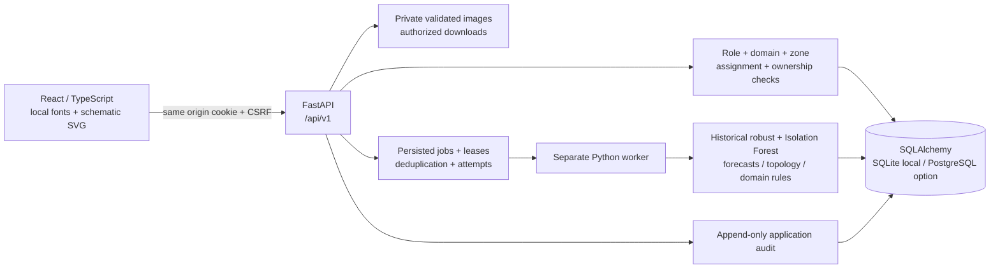

# Architecture

The API serves the production web build. The worker claims jobs with compare-and-swap updates and an expiry lease. Jobs survive process restarts; exhausted attempts become failed. Scenario outputs remain separate from baseline model snapshots. Human case decisions go through a central state machine with case versions.

Core relationships: users own sessions/reports/jobs; zones own assets; assets own interval readings; model runs retain analytical snapshots; findings create deduplicated cases; cases collect reports/evidence/audits/notifications; associations preserve separate case histories. Uploaded original values remain alongside normalized readings.

Migrations are tracked in `schema_migrations`: the baseline, evidence idempotency keys, and supporting-inspector assignments. The `case_inspectors` join table supplements the single lead stored on each case; permission checks combine assignment with current domain and zone scope. This repository uses an ordered SQLAlchemy migration registry, not Alembic. Future schema changes need a new immutable revision and upgrade tests.

The application is a prototype. SQLite is the verified local path when indicated in the verification log. Docker/PostgreSQL readiness must be checked separately; a Dockerfile is not deployment evidence.

Migration 0004 adds immutable baseline versions and an active deployment pointer per consumption domain. Candidate evaluation runs through the durable worker without publishing cases. Analytics reads select snapshots tagged with the active baseline, and routine analysis fits only its frozen training data. Administrator activation uses a version counter and an audit record; rollback restores a previously active version. See baseline-versions.md for evaluation and scope limits.

Migration 0005 adds job control revisions, private calculation checkpoints and claim tokens. Scenario publication locks and verifies the current claim; a pending pause saves the calculation before cases are created. Resume uses that checkpoint under a fresh claim. All job kinds reject stale claim publication or error writes. See worker-controls.md for pause timing and recovery behavior.

Network paths use the stored topology after authorization and optional zone filtering. Page-local closed-edge inputs produce directed shortest paths and downstream reachability without database mutation. The same authorized graph supplies the SVG, registers and calculation; hidden nodes cannot bridge paths. See network-scenarios.md.
